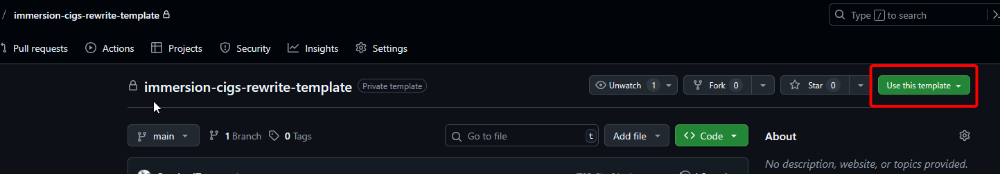
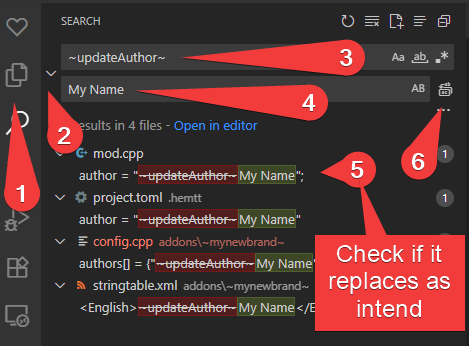
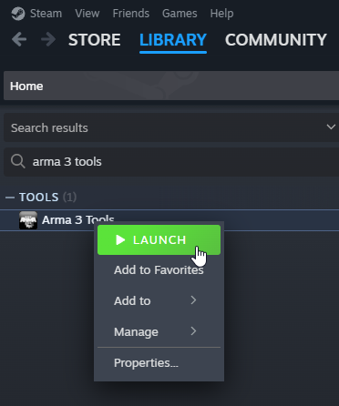
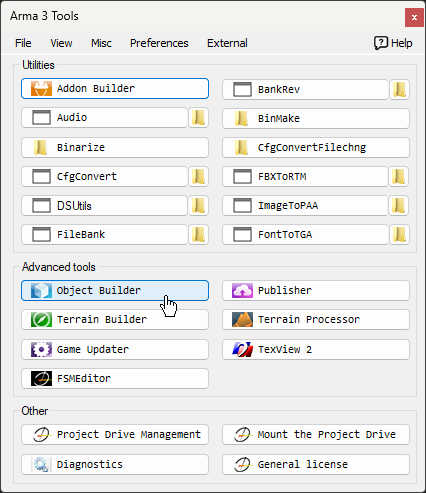
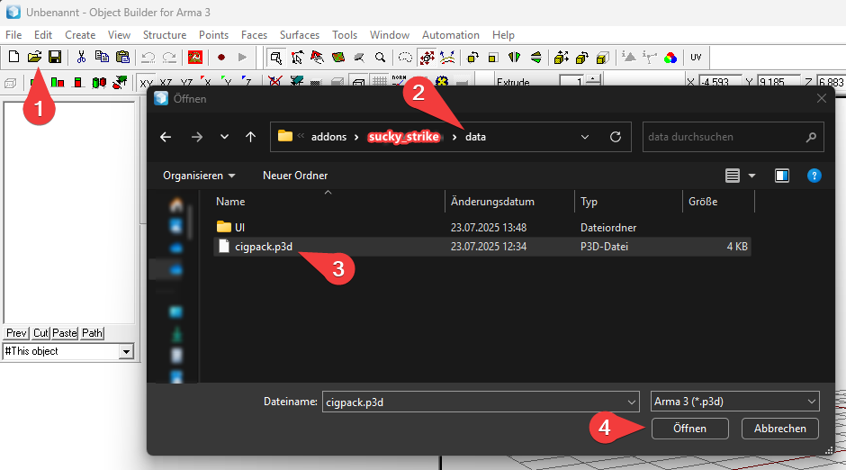
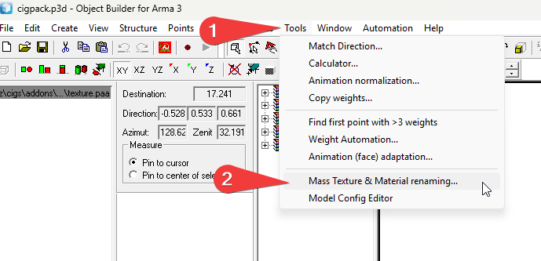
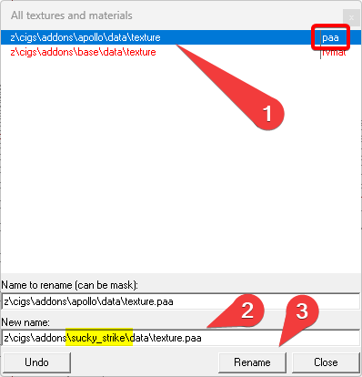
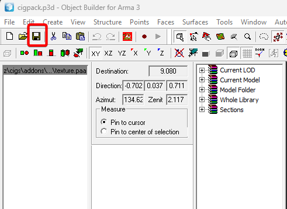

## How to Create a new Cigarette Brand - The most basic way  - a walkthrough

This example will
- be a simple retexture
- use the main mod's cigarette models (with or without a filter) and only give them your texture
- not change the cigarette package model (besides the texture)
- not use a custom .rvmat file
- will assume a brandname of `Sucky Strike`, as you surely know, you'll have to adapt it to your own liking.

> [!TIP]
> Working with an AI coding assistant? The main mod has [LLM instructions for building a brand](https://github.com/CVO-Org/immersive-cigs-rewrite/tree/main/tools/llm). They are written for the main repository, but the texture and icon steps are the same.


### 1. Get the template files and establish your workspace

<details>
<summary>Click me to reveal</summary>
<br>

Create a Repository based on the Template Repository

</details>


### 2. Rename the folder `addons\~mynewbrand~` -> `addons\sucky_strike`
<details>
<summary>Click me to reveal</summary>
<br>

- Can not have whitespaces, instead use `_`
- use lower case
- **Can not be an already existing brand(addon) name from the `Immersive Cigs - Rewrite` mod**.
</details>

### 3. Open the Repository in VS Code and use Search and Replace
<details>
<summary>Click me to reveal</summary>
<br>



- Replace the following `~placeholders~` across the whole mod directory!
- make sure to remove the `~`. These merely indicate the placeholders.

1. `~updateBrandName~` -> `sucky_strike`.
   - needs to be exact as the addon folder name
   - no whitespaces
2. `~updateBrandNameBeautified~` -> `Sucky Strike`.
   - Should be Capitalized
   - Can have Whitespaces
3. `~updateAuthor~` -> `LeetHaxor [1337]`
   - Put your Username or whatever you want to be credited with
   - Can have Whitespaces
4. `~updateURL~` -> `https://github.com/LeetHaxor/immersion-cigs-extension-sucky_strike`
   - Can be any link, commonly used to direct to YOUR mods github repo
5. `~updateSlogan~` -> `It's toasted.`
   - The first line of the pack's description in the inventory
6. `~updateFlavor1~` .. `~updateFlavor3~` -> `toasted tobacco`, `a smoky jazz bar`, ...
   - After lighting up, the player is told "Hmm, it tastes like ...!" with one of these
   - You can add more or remove them in `addons\sucky_strike\defines.hpp`
7. `~updateWorkshopID~` (only if you release from GitHub, see step 10)

Search and Replace does not touch the pack model (`cigpack.p3d`), that's step 4.
</details>


### 4. Point the pack model at your texture

<details>
<summary>Click me to reveal</summary>
<br>

`addons\sucky_strike\data\cigpack.p3d` points at `cigx\cigs\addons\~updateBrandName~\data\texture.paa`. Replace the placeholder with your addon name, from the repository root:

```powershell
python tools/mlod.py addons/sucky_strike/data/cigpack.p3d --rename ~updateBrandName~ sucky_strike
```

It needs Python 3 and nothing else, and prints how many paths it changed (6). Run `python tools/mlod.py addons/sucky_strike/data/cigpack.p3d` to see the paths.

The model's material points at the main mod (`zrn\cigs\addons\base\data\texture.rvmat`). Leave that as it is.

#### Or by hand in Object Builder

<details>
<summary>Click me to reveal</summary>
<br>

#### 1. Open Arma 3 Tools


#### 2. Open Object Builder


#### 3. Open cigpack.p3d


#### 4. Open Mass Texture Renaming Tool


#### 5. Update the Path tho the .paa texture


#### 6. Save Changes to the cigpack.p3d file

</details>

Keep `addons\sucky_strike\data\model.cfg` next to the model. It gives the pack model its own `CfgModels` entry. Without it the model uses the engine's global default, which other mods sometimes break.
</details>

### 5. (Optional) A cigarette without a filter
<details>
<summary>Click me to reveal</summary>
<br>

The template uses the main mod's 85 mm cigarette with a filter. For a filterless one (56 mm, paper down to the mouth end with a tobacco end), replace `QPATH_BASE_MODEL_CIG` with `QPATH_BASE_MODEL_NOFILTER_CIG` in `addons\sucky_strike\cigs_glasses.hpp` and `addons\sucky_strike\cigs_hmd.hpp`, for every stage (0 to 4, including `uniformModel` and `modelOff`).

The texture layout is the same. The filter part of the texture (u 391–585) isn't used.
</details>

### 6. (Optional) Adjust Cigarette Burn Time, Cigpack Size and Flavour
<details>
<summary>Click me to reveal</summary>
<br>

- Open and edit `addons\sucky_strike\defines.hpp`
- follow provided advice inside
</details>

### 7. Update textures
<details>
<summary>Click me to reveal</summary>

- `addons\sucky_strike\data\texture.paa`
  - The texture file for the 3d Models of both, the cig-pack as well as for the individual cigarette stages.
- `addons\sucky_strike\data\UI\gear_cigpack_x_ca.paa`
  - The Inventory Icon for the cigarette pack.
- `addons\sucky_strike\data\UI\gear_cig0_x_ca.paa` .. `gear_cig4_x_ca.paa`
  - The Inventory Icons for each individual stage of the cigarette.
    - `cig0` is the unused cigarette.
    - `cig1` .. `cig4` is the burning cigarette during its different stages (shorter).
- `addons\sucky_strike\data\UI\aceax_logo_ca.paa`
  - Your pack front on a transparent square, for the ACE Arsenal Extended brand button (step 11).
- `img\mod-rw-trans.paa` (Optional)
  - This is the Image used by the mod as as mod icon and shall support transparancy

#### The logo on the cigarette paper

Print the logo on the paper's end next to the filter (u 330–389): that end stays as the cigarette burns down.

Turn the logo so it reads from the front of the cigarette: its top points towards the filter (towards the mouth end without a filter), so text runs top to bottom in the strip. Text and a mark go on top of each other along the cigarette, the mark nearer the filter. On a cigarette without a filter, keep the logo a bit away from the mouth end: around u 273–327.

The main mod's [Gear Icons](https://github.com/CVO-Org/immersive-cigs-rewrite/blob/main/docs/gear-icons.md) page shows the strip's layout.

#### With Photoshop

Within the Mod Folder Structure, you will find the folder `\photoshop-files\`. Inside, you'll find mutliple folders each with a template `.psd` and other resource files.

#### With the main mod's scripts

The main mod has Python scripts that build the texture from one picture per pack face and render all inventory icons from it, so they match the other brands. They need the main mod's models, so run them in a copy of the [main repository](https://github.com/CVO-Org/immersive-cigs-rewrite):

1. Clone the main repository and copy your `addons\sucky_strike` folder into its `addons\`.
2. Follow [tools/gear_icons/README.md](https://github.com/CVO-Org/immersive-cigs-rewrite/blob/main/tools/gear_icons/README.md) there:
   - `texture_compose.py guide` draws the layout, `texture_compose.py compose ... --paa addons/sucky_strike/data/texture.paa` builds the texture.
   - `gear_icons.py sucky_strike --apply` renders the pack and cig0..4 icons into `addons\sucky_strike\data\UI\`. It sees by itself whether your cigarette has a filter.
3. Copy `addons\sucky_strike\data\` back into your mod.

They need Python 3 with Pillow (`pip install pillow`) and `hemtt` on your `PATH`.

#### The ACE Arsenal Extended logo

Once your texture is done, cut the pack front out of it, from your mod's repository root:

```powershell
python tools/aceax_logo.py sucky_strike
```

<br>
</details>

### 8. Update `stringtable.xml`
<details>
<summary>Click me to reveal</summary>
<br>

The Stringtable.xml will contain the localized text for your cigarette brand. Here, you will be able to change the following:
- Displayname Cigarettes
- Displayname Cigpacks
- Description Cigpacks
- Author
- URL

Every text comes in the 10 languages the main mod has. Your slogan goes into all of them in English; translate it if you like.

#### Linebreak

To place an linebreak within an items description, the following has to be used: `&lt;br/&gt;`
</details>


### 9. Build and test the mod by using hemtt
<details>
<summary>Click me to reveal</summary>
<br>

[VSCode Docs: How to use the Terminal](https://code.visualstudio.com/docs/terminal/getting-started)
[Hemtt Docs: Launch](https://hemtt.dev/commands/launch.html)

`hemtt launch` builds your mod and starts the game with CBA, ACE, ZEN and the main mod's dev version from the Workshop.

The arsenal only shows the full cigarette (`cig0`), like the main mod's brands. To see every burn stage while testing, set `_DEV_VERSION_` to `1` in `include\zrn\cigs\addons\main\debug_mode.hpp`. Set it back to `0` before you release.

`hemtt check` may warn about missing stringtable keys (`str_cigs_core_glasses_stage0` etc.). These come from the main mod and exist in game, so you can ignore them.

</details>

### 10. Publish the Mod
<details>
<summary>Click me to reveal</summary>
<br>

[VSCode Docs: How to use the Terminal](https://code.visualstudio.com/docs/terminal/getting-started)
[Hemtt Docs: Release](https://hemtt.dev/commands/release.html)

Once you're happy with the state of the mod, you can use `hemtt release` to build the mod.
Take the .zip and use the `Arma 3 Publisher` from `Arma 3 Tools` to release your mod.

To release automatically from GitHub instead, see `.github/workflows/release.yml`: replace `~updateWorkshopID~` with the Workshop ID of your mod and add `STEAM_USERNAME` / `STEAM_PASSWORD` as repository secrets.

</details>

### 11. ACE Arsenal Extended
<details>
<summary>Click me to reveal</summary>
<br>

With [ACE Arsenal Extended](https://steamcommunity.com/sharedfiles/filedetails/?id=2522638637) loaded, the arsenal groups all cigarettes into one entry with a brand and a stage selector. Your brand joins it through two files that come with the template:

1. `addons\sucky_strike\compat_aceax\config.cpp`: a sub-config that only loads with ACE Arsenal Extended. Your stage 0 cigarette (`cig0`, `cig0_nv`) is `scope = 1`, hidden from the arsenal and the Eden lists, like the main mod's brands. The sub-config sets it back to `scope = 2` and includes `aceax.hpp`. Without ACE Arsenal Extended it's dropped (`skipWhenMissingDependencies`), so your mod doesn't depend on it.
2. `addons\sucky_strike\aceax.hpp`: adds your brand to the main mod's brand selector (`values[] += { ... }`, which appends instead of replacing the main mod's list) and maps your cigarettes to it. It uses `COMPONENT`, so there's nothing to rename besides the placeholders from step 3.

The button shows your pack front (`data\ui\aceax_logo_ca.paa`, step 7). For a text button instead, set `label` to your brand name and remove the `image` line (see the comment in `aceax.hpp`).

`hemtt launch aceax` starts the game with ACE Arsenal Extended.

</details>

### 12. (Optional) Let AI carry your brand
<details>
<summary>Click me to reveal</summary>
<br>

Immersive Cigs hands out cigarettes to AI units. Which packs they get comes from config, and your mod can add to it:

- [Faction presets](https://github.com/CVO-Org/immersive-cigs-rewrite/blob/main/docs/modders.md#faction-presets): give a faction (yours or another mod's) your packs.
- [Default pack presets](https://github.com/CVO-Org/immersive-cigs-rewrite/blob/main/docs/modders.md#default-pack-presets): the packs each side gets by default.

</details>

